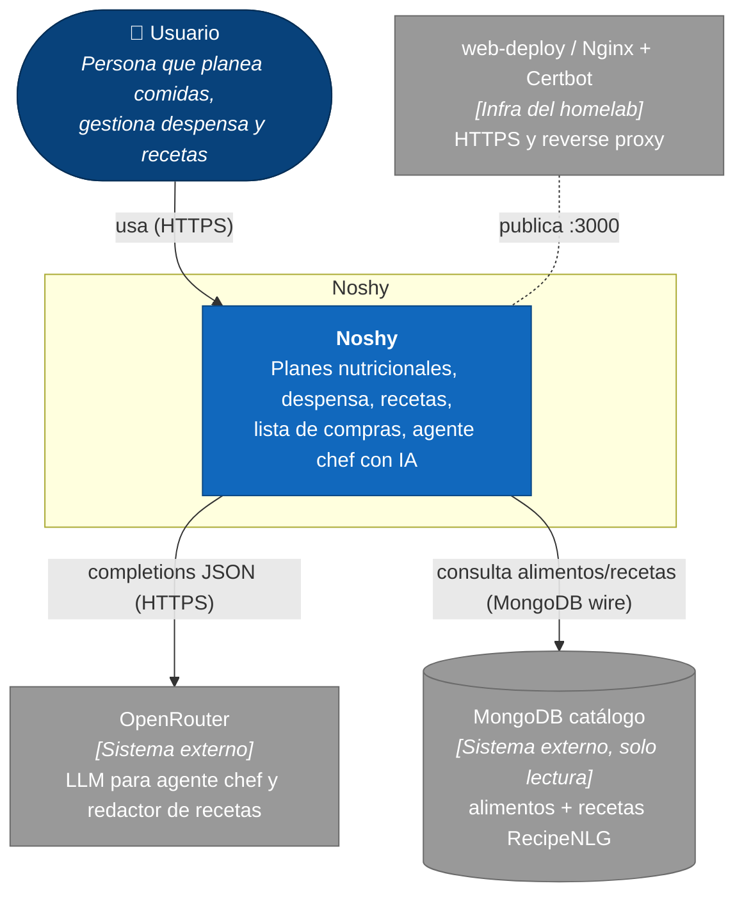
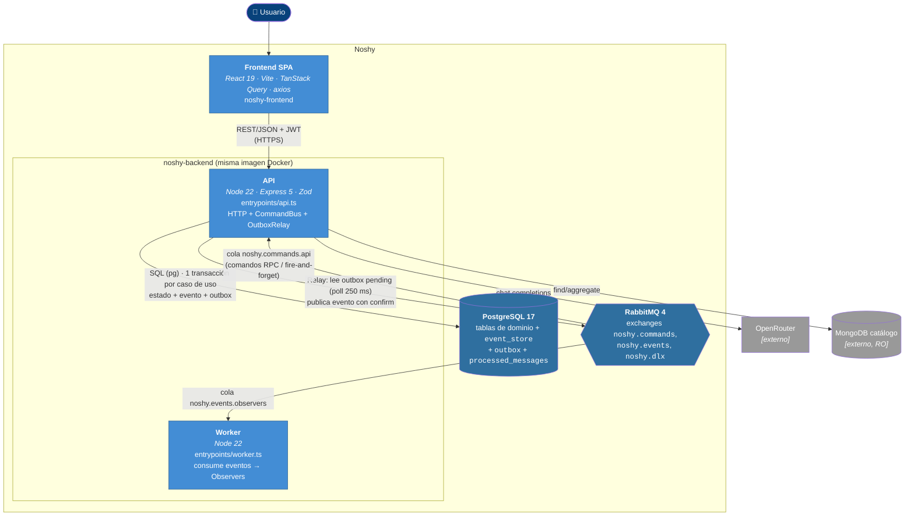
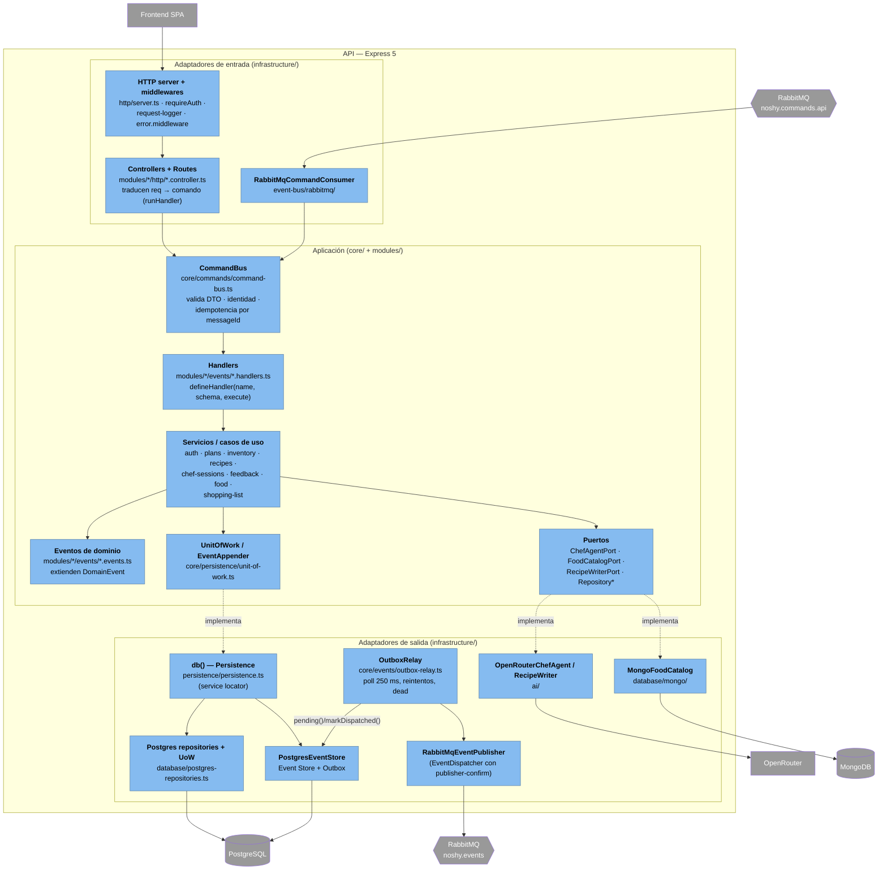
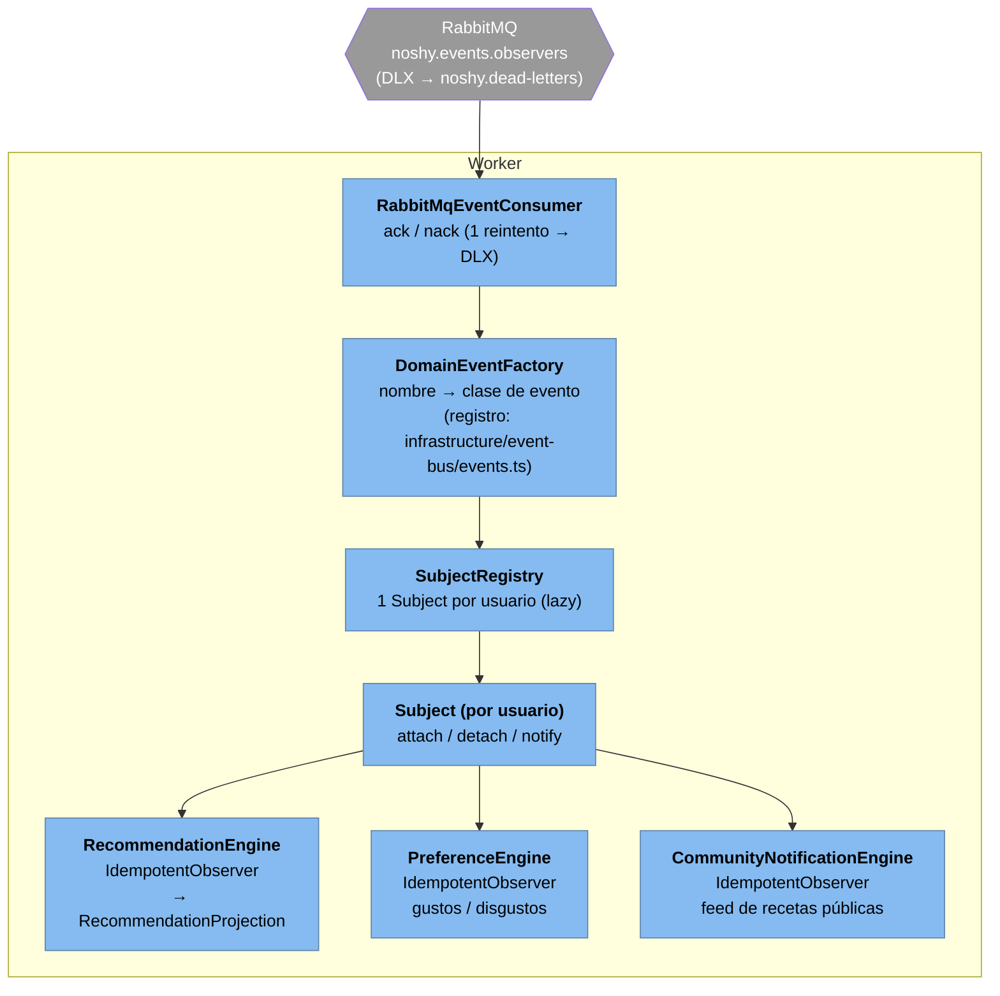
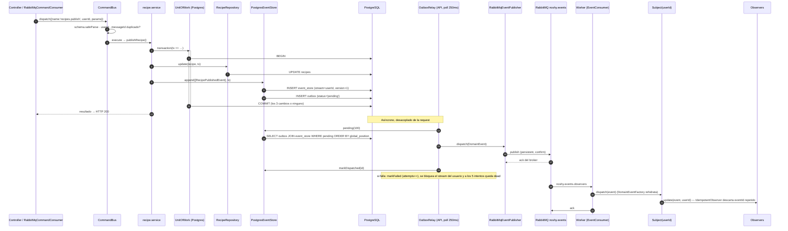
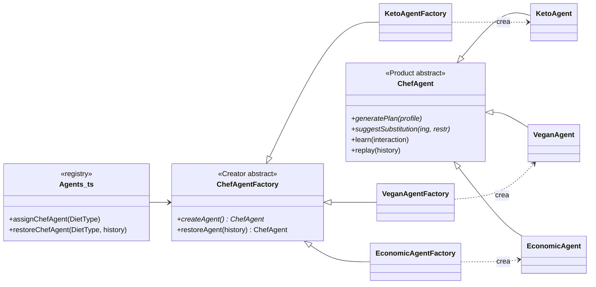

# Noshy Backend

API HTTP de Noshy para el MVP web. Está construida con Node.js, TypeScript, Express 5 y Zod.

## Desarrollo

Desde `backend/`:

```bash
pnpm install
pnpm dev
```

Comprobaciones:

```bash
pnpm test
pnpm build
```

Sin variables de entorno todo corre en memoria (útil para tests). Para la arquitectura completa:

```powershell
pnpm infra:up                     # Postgres (puerto 5433) + RabbitMQ (5672, panel en :15672)
Copy-Item .env.example .env       # y completa DATABASE_URL, RABBITMQ_URL, JWT_SECRET, OPENROUTER_API_KEY
pnpm dev                          # API: migra al arrancar, HTTP + comandos por RabbitMQ + relay del outbox
pnpm dev:worker                   # Worker: consume eventos y alimenta los observers
```

La API, el worker y `pnpm db:migrate` cargan `backend/.env` al arrancar (las variables de la terminal tienen prioridad). Los tests no lo leen.

Para probar la API a mano usa la colección de [Bruno](bruno/README.md) (46 requests del flujo MVP, con guía paso a paso). Desde la terminal: `pnpm test:bruno` con la API corriendo.

Con `DATABASE_URL` y `RABBITMQ_URL` definidas, `pnpm test` también corre los tests de integración contra Postgres y RabbitMQ reales (usan schemas y exchanges temporales y los borran al terminar).

## Despliegue con Docker (homelab / server)

Todo corre en contenedores en **modo dev** (`tsx watch`, sin compilar): Postgres, RabbitMQ, la API y el worker, con reinicio automático. Solo hace falta Docker y git (no Node ni pnpm).

```bash
git clone --recurse-submodules -b dev https://github.com/maybeimder/noshy.git
cd noshy/backend
cp .env.example .env    # define JWT_SECRET (para que los tokens sobrevivan reinicios) y OPENROUTER_API_KEY
```

**Con dominio + HTTPS** (script `web-deploy`, Nginx + Certbot): desde `noshy/backend`,

```bash
sudo web-deploy api.tudominio.com -e tu@email.com
# cuando pregunte el puerto HOST: 3000
```

**Sin dominio** (solo red local): pon `API_BIND=0.0.0.0` en `.env` y `docker compose up -d --build`; la API queda en `http://<ip-del-server>:3000`.

- `api` es el primer servicio del compose a propósito: `web-deploy` genera su override de puertos para el primero. Ese override (`docker-compose.override.yml`) está en `.gitignore`.
- Todo escucha en `127.0.0.1` del server; con `web-deploy` solo Nginx (80/443) queda expuesto. Para el panel de RabbitMQ desde tu PC: `ssh -L 15672:localhost:15672 <server>` y abre http://localhost:15672 (`noshy` / `noshy`).
- La API aplica las migraciones al arrancar. Los datos viven en el volumen `noshy-postgres-data`.
- CORS queda en `*` mientras no definas `CORS_ORIGIN`, así que el frontend puede llamar desde cualquier IP.
- `./src` está montado en los contenedores: tras un `git pull`, `tsx watch` recarga solo en Linux. Si no lo hace (o cambiaron dependencias), usa la tabla de abajo.

| Tarea | Comando |
| ----- | ------- |
| Actualizar código (solo `src/`) | `git pull && docker compose restart api worker` |
| Actualizar dependencias (`package.json`) | `git pull && docker compose up -d --build` |
| Ver logs | `docker compose logs -f api worker` |
| Estado | `docker compose ps` |
| Reiniciar | `docker compose restart api worker` |
| Apagar (conserva los datos) | `docker compose down` |
| Respaldar la base | `docker exec noshy-postgres pg_dump -U noshy noshy > backup.sql` |

Para desarrollo en tu máquina sigue usando `pnpm infra:up` (solo Postgres + RabbitMQ) y `pnpm dev`.

`pnpm build` + `pnpm start` también funcionan (compilan a `dist/` como CommonJS), pero el despliegue actual no los usa.

## Arquitectura

Orientada a eventos, con Transactional Outbox y Event Sourcing:

- **Entrada única:** los controllers HTTP y el consumer de RabbitMQ despachan al mismo `CommandBus` (`modules/*/events/*.handlers.ts`), que valida con los mismos DTOs y llama a los mismos servicios.
- **Transactional Outbox:** cada mutación guarda su estado, su evento (`event_store`) y su mensaje (`outbox`) en una sola transacción. El `OutboxRelay` entrega el outbox a RabbitMQ (`noshy.events`) o, sin RabbitMQ, a los observers del mismo proceso.
- **Event Sourcing:** las proyecciones (recomendaciones, preferencias, comunidad) se reconstruyen reproduciendo `event_store`.
- **GoF:** Observer (`Subject` por usuario y observers idempotentes) y Factory Method (agentes chef por tipo de dieta).

## Configuración

Variables opcionales:

| Variable          | Valor por defecto | Descripción                                         |
| ----------------- | ----------------- | --------------------------------------------------- |
| `PORT`            | `3000`            | Puerto HTTP entre 1 y 65535                         |
| `CORS_ORIGIN`     | `*`               | Origen permitido por CORS                           |
| `JSON_BODY_LIMIT` | `1mb`             | Límite de cuerpos JSON, por ejemplo `512kb` o `2mb` |
| `DATABASE_URL`    | —                 | Postgres (`postgres://...`). Sin ella, estado en memoria |
| `RABBITMQ_URL`    | —                 | RabbitMQ (`amqp://...`). Sin ella, eventos en proceso |
| `JWT_SECRET`      | aleatorio         | Secreto (≥32 caracteres) para firmar los JWT. **Obligatorio con `NODE_ENV=production`** |
| `JWT_EXPIRES_IN`  | `7d`              | Vigencia del token, por ejemplo `15m`, `12h` o `7d` |
| `OPENROUTER_API_KEY` | —              | Activa el agente chef con OpenRouter. Sin ella, `respond` devuelve 503 |
| `OPENROUTER_MODEL`   | modelos `:free` | Lista separada por comas; el primero es el preferido y el resto respaldo |
| `MONGO_URL`          | —               | Catálogo de alimentos y recetas (Mongo de solo lectura). Sin ella, `/food` devuelve 503 |

La configuración se valida al iniciar mediante `src/infrastructure/config/env.ts`.

## Autenticación

Los endpoints protegidos usan:

```http
Authorization: Bearer <token>
```

`POST /auth/register` y `POST /auth/login` devuelven un **JWT HS256** firmado con `JWT_SECRET` (emisor `noshy`, audiencia `noshy-api`, `sub` = id del usuario). Se rechazan los tokens adulterados, expirados o firmados con otro secreto. Sin `JWT_SECRET` la API usa un secreto temporal y los tokens dejan de valer al reiniciarla.

No hay revocación ni refresh token: un token vale hasta que expira.

## Contratos principales

| Área             | Operaciones                                                                      |
| ---------------- | -------------------------------------------------------------------------------- |
| Auth             | `POST /auth/register`, `POST /auth/login`, `GET /auth/me`                        |
| Plan nutricional | `POST /plans`, `GET /plans`, `GET /plans/active`, `PUT /plans/active`            |
| Inventario       | `POST/GET /inventory/items`, `PATCH/DELETE /inventory/items/:id`                 |
| Recetas propias  | `POST/GET /recipes`, `PATCH/DELETE /recipes/:id`, publicar y retirar publicación |
| Comunidad        | `GET /community/recipes`, `GET /community/recipes/:id`                           |
| Agente chef      | sesiones, contexto, mensajes y `POST /chef/sessions/:id/respond`                 |
| Feedback         | `POST/GET /feedback`, `GET /recommendations`                                     |
| Compras          | `POST /shopping-list` desde recetas guardadas o recetas inline del agente        |
| Alimentos        | `GET /food/products?q=`, `GET /food/products/:id`, `POST /food/macros`, `GET /food/history` |
| Recetas IA (RAG) | `GET /food/library/browse`, `GET /food/library/recipes?ingredients=`, `GET /food/library/recipes/:id`, `POST /food/recipes/generate`, `GET /food/recipes/:id` |

Los errores de rutas desconocidas y JSON inválido usan el formato:

```json
{
  "error": {
    "code": "ROUTE_NOT_FOUND",
    "message": "Ruta no encontrada."
  }
}
```

## Flujo MVP

```text
Plan nutricional + preferencias
	-> sesión del agente chef
	-> receta adaptada al inventario
	-> lista de compras
	-> feedback comportamental
	-> comunidad de recetas públicas
```

## Workflow Git

Cada feature se crea desde el `dev` remoto actualizado, se implementa y valida en su propia rama, se publica en el remoto y finalmente se fusiona a `dev`.

## Agente chef (OpenRouter)

`POST /chef/sessions/:id/respond` usa `OpenRouterChefAgent` (`src/infrastructure/ai/`). Por defecto usa modelos **gratuitos** (`nvidia/nemotron-3-super-120b-a12b:free`, con respaldo en `google/gemma-4-31b-it:free` y `openrouter/free`), así que no consume créditos. El agente recibe el plan, las preferencias, el inventario, la receta y el historial de la sesión, y responde en JSON con un mensaje y los eventos de feedback que detecte (que se registran como `feedback.feedback_recorded`).

Los modelos gratuitos tienen límites de uso por minuto y por día, y sus proveedores pueden registrar los prompts: no envíes datos sensibles reales.

## Alimentos y recetas (MongoDB)

El módulo `food` consulta un MongoDB **de solo lectura** (base `food`, usuario con rol `read`), aparte de Postgres y RabbitMQ:

- **`products_slim`** (catálogo de ~7.6k alimentos): `GET /food/products?q=arroz blanco` para el dropdown. Normaliza el texto (minúsculas, sin tildes, sin conectores como "de"), exige todas las palabras y excluye `suspect`. Trae hasta 100 candidatos y los ordena por **relevancia** (`modules/food/food-ranking.ts`), no por popularidad: puntúa que la palabra sea el núcleo del nombre y palabra completa ("sal" ≠ "salchicha") y penaliza sabores ("sabor pollo", "limón pimienta"), procesados, marcas de snacks y mezclas. Cada resultado trae `exactMatch: true` cuando el producto ES el alimento buscado.
- **Ojo con los datos:** hoy el catálogo no tiene genéricos USDA (`source: "usda"`, `state`, `pairKey` están vacíos) ni varios básicos crudos (cebolla, ajo, zanahoria). Cuando no hay un match confiable, la receta generada omite ese ingrediente de los macros y lo avisa en `warnings`, en vez de sumar los de un snack.
- **Macros** (`POST /food/macros`): por gramos o por porción (`serving` + `quantity`); sin cantidad usa 100 g y lo avisa. Con `"log": true` registra la comida (evento `food.meal_logged`).
- **`recipes_raw`** (RecipeNLG, ~2.2M recetas en inglés, sin calorías): `GET /food/library/recipes?ingredients=pollo,arroz`. Los ingredientes se traducen al inglés con OpenRouter (con caché en memoria) y se buscan por `ner`.
- **Biblioteca paginada** (`GET /food/library/browse`): sin parámetros devuelve una página **aleatoria** de 20 recetas; `sort=recent|oldest` ordena por id del dataset (RecipeNLG no tiene fechas, así que "recent" son las últimas agregadas). Filtros: `source` (`Gathered`/`Recipes1M`) y `maxIngredients`. Paginación por cursor (`nextCursor`, sin `skip`): cualquier página cuesta lo mismo, también en modo aleatorio, que arranca en un id al azar y recorre toda la colección sin repetir. Cada tarjeta trae `tags` e `image` (hoy siempre `null`: el dataset no trae imágenes).
- **RAG** (`POST /food/recipes/generate`): trae recetas de referencia, el modelo de OpenRouter redacta una receta en español y **el back calcula los macros** cruzando cada ingrediente con `products_slim` (en recetas, sin indicación se asume crudo). Registra `food.recipe_generated` y devuelve `recipeInput`, listo para `POST /recipes`.
- **Tags de recetas** (`tags` en la biblioteca y en las recetas generadas): `diet` (vegetariana, vegana), `allergens` (gluten, leche, huevo, maní, frutos secos, soya, pescado, mariscos, ajonjolí), `mealTypes` (postre, sopa, ensalada, desayuno, salsa… o el tipo que da el modelo), `proteins` (pollo, res, cerdo, pescado, legumbres…), `nutrition` (alto en proteína, bajo en carbohidratos… solo con macros) y `effort` (pocos ingredientes, rápida). Se deducen con un léxico bilingüe (`modules/food/food-tags.ts`) más los alérgenos y grupos de los productos del catálogo. Son orientativos: `allergens` lista lo detectado y nunca se afirma "sin gluten".
- **Historial** (`GET /food/history`, `GET /food/recipes/:id`): no tiene tabla propia, se reconstruye reproduciendo los eventos `food.*` del usuario (Event Sourcing).

Todo pasa por el `CommandBus` (`food.*` en `modules/food/events/food.handlers.ts`), así que también se puede disparar por RabbitMQ. El adaptador (`infrastructure/database/mongo/`) solo usa `find` y `aggregate`, con proyección, `limit` y `maxTimeMS`; el texto del usuario se escapa antes de entrar a un regex y los DTO rechazan objetos (`{ "$ne": "" }`). Si Mongo no responde al arrancar, la API sigue arriba, reintenta con backoff y responde 503 mientras tanto. Al conectar avisa en el log si faltan los índices `products_slim.popularity` o `recipes_raw.ner`.

RecipeNLG es solo para uso educativo/investigación no comercial: se usa como referencia interna, no se redistribuye.

El frontend y Redis están fuera del alcance de este submódulo en la etapa actual.

---
# DIAGRAMAS

. C1 — Contexto del sistema



---

## 2. C2 — Contenedores

Dos procesos Node.js con **la misma imagen** (`Dockerfile`, `docker-compose.yml`): `api` y `worker`.



**Modo degradado (sin variables de entorno):** sin `DATABASE_URL` todo es memoria (`InMemoryEventStore`, repos in-memory); sin `RABBITMQ_URL` el relay entrega directo al `SubjectRegistry` del mismo proceso (`entrypoints/api.ts:117-131`). Por eso los tests corren sin infraestructura.

---

## 3. C3 — Componentes

### 3.1 Contenedor API



### 3.2 Contenedor Worker



### 3.3 Módulos de dominio (bounded contexts)

Cada módulo repite la misma estructura (`http/` controller+routes+dto · `events/` handlers+events(+observers) · `*.service.ts` · `*.model.ts` · `*.repository.ts`).

| Módulo | Eventos que emite | Observers |
|---|---|---|
| `auth` | `auth.user_registered`, `auth.user_logged_in` | — |
| `plans` | `plans.nutrition_plan_created/updated` | — |
| `inventory` | `inventory.item_added/updated/removed` | — |
| `recipes` | `recipe_created/updated/deleted/published/unpublished` | `CommunityNotificationEngine` |
| `chef-sessions` | `chef.session_opened`, `chef.message_recorded`, `chef.session_closed`, `chef.session_recovery_required` | `PreferenceEngine` |
| `feedback` | `feedback.feedback_recorded` | `RecommendationEngine`, `PreferenceEngine` |
| `food` | `food.recipe_generated`, `food.meal_logged` | (se reproduce con `FoodHistoryProjection`) |
| `shopping-list` | `shopping.list_generated` | — |
| `recommendations` | — (solo proyección y observer) | `RecommendationEngine` |

---

## 4. C4 — Código (los tres flujos que importan)

### 4.1 Escritura con Transactional Outbox

Ejemplo: `publishRecipe` (`modules/recipes/recipe.service.ts`).



Garantías: **at-least-once** end-to-end (el relay reintenta; el worker puede recibir duplicados) + **idempotencia** (`IdempotentObserver` por `eventId`; `CommandBus` por `messageId` en `processed_messages`) + **orden por usuario** (stream bloqueado mientras uno de sus eventos falla).

### 4.2 Clases: Observer, Outbox, Event Sourcing

```mermaid
classDiagram
    direction LR

    class DomainEvent~TPayload~ {
        <<abstract>>
        +eventName: string (static)
        +payload: TPayload
        +eventId: string
        +occurredAt: string
        +userId: string
    }
    class RecipePublishedEvent
    class FeedbackRecordedEvent
    DomainEvent <|-- RecipePublishedEvent
    DomainEvent <|-- FeedbackRecordedEvent

    class DomainEventFactory {
        <<Factory>>
        -typesByName: Map
        +register(type)
        +create(StoredEvent) DomainEvent
    }
    DomainEventFactory ..> DomainEvent : instancia por nombre

    class EventDispatcher {
        <<interface>>
        +dispatch(event)
    }
    class SubjectRegistry {
        +subjectFor(userId) Subject
        +dispatch(event)
    }
    class Subject {
        <<Subject GoF>>
        +userId
        +attach(Observer)
        +detach(Observer)
        +notify(event)
    }
    class Observer {
        <<interface>>
        +update(event, userId)
    }
    class IdempotentObserver {
        <<abstract, Template Method>>
        -processed: Set~eventId~
        +update(event, userId)
        +reset()
        #handle(event, userId)*
        #clearState()*
    }
    class RecommendationEngine
    class PreferenceEngine
    class CommunityNotificationEngine

    EventDispatcher <|.. SubjectRegistry
    EventDispatcher <|.. RabbitMqEventPublisher
    SubjectRegistry "1" o-- "*" Subject
    Subject "1" o-- "*" Observer
    Observer <|.. IdempotentObserver
    IdempotentObserver <|-- RecommendationEngine
    IdempotentObserver <|-- PreferenceEngine
    IdempotentObserver <|-- CommunityNotificationEngine

    class OutboxRelay {
        +drain()
        +drainAll()
        +start(intervalMs)
    }
    class Outbox {
        <<interface>>
        +pending(limit)
        +markDispatched(id)
        +markFailed(id, err, max)
    }
    class PersistentEventStore {
        <<interface>>
        +append(events, tx)
        +readStream(streamId)
        +readAll()
    }
    class PostgresEventStore
    class InMemoryEventStore
    Outbox <|.. PostgresEventStore
    PersistentEventStore <|.. PostgresEventStore
    Outbox <|.. InMemoryEventStore
    OutboxRelay --> Outbox
    OutboxRelay --> DomainEventFactory
    OutboxRelay --> EventDispatcher
```



### 4.3 Factory Method de agentes chef (existe, sin conectar)



---

